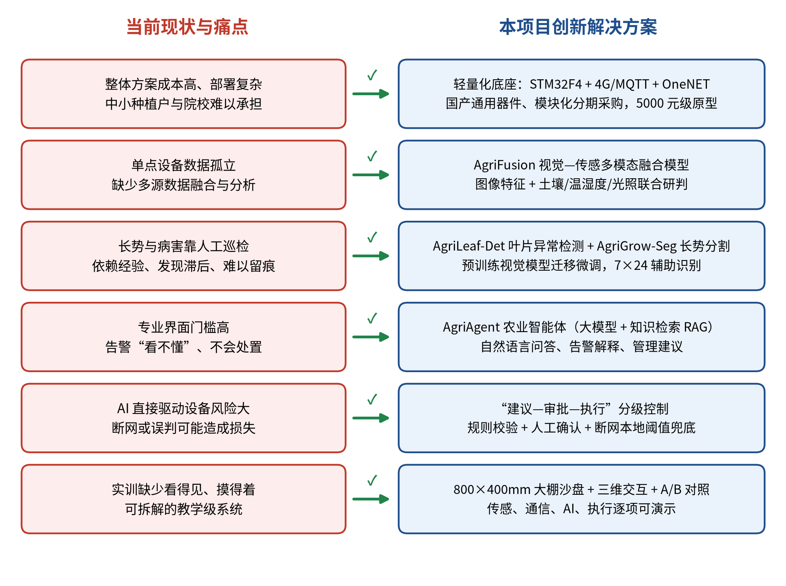
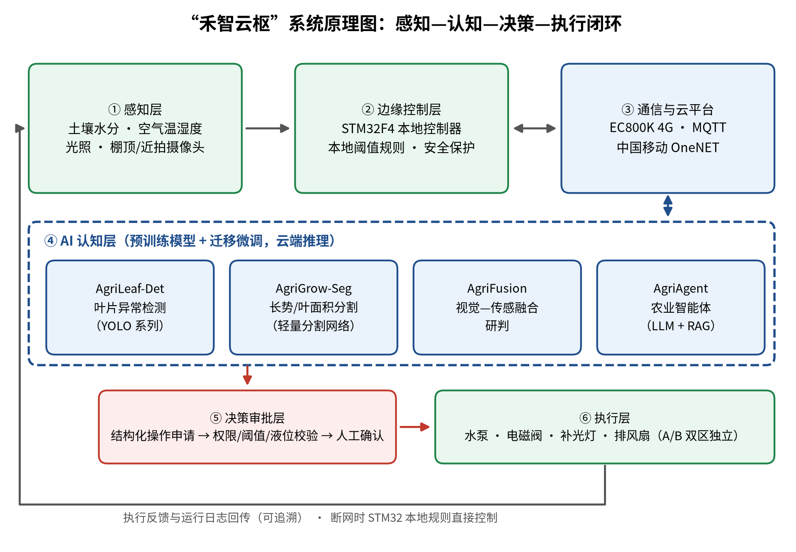
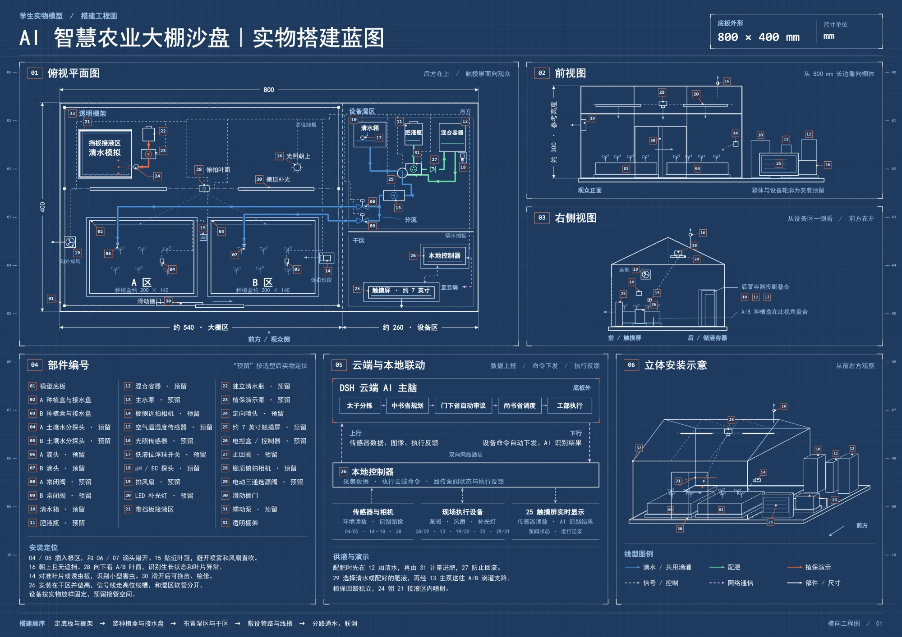

# 禾智云枢：基于多模态 AI 视觉与农业智能体的设施农业一体化平台

广东交通职业技术学院大学生创新创业训练计划（创业实践项目）申报材料。800×400mm 智慧农业大棚沙盘，实现“感知—决策—执行”闭环。

> 状态：方案与工程设计阶段（TRL 3–4）。STM32F4、EC800K 4G/MQTT/OneNET、DS18B20 已有实践基础；AI 视觉、农业智能体、水肥联动为拟实施内容，指标以后续实测为准。

## 要解决的问题

## 系统原理

拟采用的 AI 模型（项目内部命名，均为预训练模型迁移微调）：

| 模型 | 功能 |
|---|---|
| AgriLeaf-Det | 叶片异常检测（YOLO 系列） |
| AgriGrow-Seg | 长势与叶面积分割 |
| AgriFusion | 视觉—传感多模态融合研判 |
| AgriAgent | 农业智能体（大模型 + RAG + 规则引擎，“建议—审批—执行”） |

## 设计成果

三维交互展示：[默认视角](docs/三维展示-默认视角.png) · [俯视](docs/三维展示-俯视.png) · [前视](docs/三维展示-前视.png)

## 文件

- [项目申报书_公开版.docx](项目申报书_公开版.docx)：申报书全文（成员学号、邮箱、手机号已打码）
